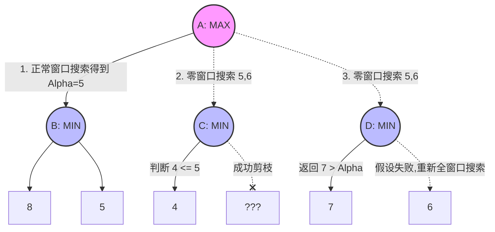

　　主要变例搜索(PVS, Principal Variation Search)是提高“Alpha-Beta”算法效率的一种方法。
　　在Alpha-Beta搜索中，任何结点都属于以下三种类型：
　　1. Alpha结点。每个搜索都会得到一个小于或等于Alpha的值，这就意味着这里没有一个着法是好的，可能是因为这个局面对于要走的一方太坏了。
　　2. Beta结点。至少一个着法会返回大于或等于Beta的值。
　　3. 主要变例(PV)结点。有一个或多个着法会返回大于或等于Alpha的值(即PV着法)，但是没有着法会返回大于或等于Beta的值。
　　有些时候你可以很早地判断出你要处理的是哪类结点。如果你搜索的第一个着法高出边界(返回一个大于或等于Beta的值)，那么很明显你得到Beta结点。如果低出边界(返回一个小于或等于Alpha的值)，假设你的着法顺序非常好，那么你有可能得到Alpha结点。如果返回值在Alpha和Beta之间，你可能得到PV结点。
　　当然，有两种情况你可能会判断错误。当你高出边界时，你返回Beta，因此你不会犯错误，但是如果第一个着法低出边界或者是PV着法时，仍然有可能在下一个着法得到更高的值。
　　主要变例搜索作了假设，如果你在搜索一个结点时找到一个PV着法，那么你就得到PV结点。也就是说假设你的着法排序已经足够好了，使得你不必在其余的着法中找更好的PV着法或者高出边界的着法(这就会使结点变成Beta结点)。
　　你找到一个着法其值在Alpha和Beta之间，那么对其余的着法，搜索的目标就是证明他们都是坏的。跟要搜索出更好的着法相比，这种搜索也许要快一些。
　　如果这个算法发现判断是错的，即其中一个后续着法比第一个PV着法好，那么它会被再一次搜索，这次使用正常的Alpha-Beta搜索方法。这种情况有时会发生，这样就浪费时间了，但是这些时间通常不会超过面所说的“证明是坏着法”所节约下来的时间。
　　算法如下，是从Alpha-Beta算法改过来的，改过的地方用醒目的字标出：
　
int AlphaBeta(int depth, int alpha, int beta) {
　BOOL fFoundPv = FALSE;
　if (depth == 0) {
　　return Evaluate();
　}
　GenerateLegalMoves();
　while (MovesLeft()) {
　　MakeNextMove();
　　if (fFoundPv) {
　　　val = -AlphaBeta(depth - 1, -alpha - 1, -alpha);
　　　if ((val > alpha) && (val < beta)) { // 检查失败
　　　　val = -AlphaBeta(depth - 1, -beta, -alpha);
　　　}
　　} else
　　　val = -AlphaBeta(depth - 1, -beta, -alpha);
　　}
　　UnmakeMove();
　　if (val >= beta) {
　　　return beta;
　　}
　　if (val > alpha) {
　　　alpha = val;
　　　fFoundPv = TRUE;
　　}
　}
　return alpha;
}
　
　　算法的核心部分就是函数中间醒目的“if”块中的内容。如果没有找到PV结点，“AlphaBeta()”函数就正常调用，如果找到了一个，那么情况就变了。不是用常规的窗口(Alpha, Beta)，而是用(Alpha, Alpha + 1)来搜索。这样做的前提是，搜索必须返回小于或等于Alpha的值，如果确实这样，那么把窗口的上面部分去掉就会导致更多的截断。当然，如果前提是错的，返回值是Alpha + 1或更高，那么搜索必须用宽的窗口重做。

### PVS算法博弈树示例与说明

为了更好地理解PVS为何要在找到PV节点后使用 `(Alpha, Alpha + 1)` 的零窗口（期望窗口）进行搜索，我们可以看下面这棵博弈树的例子：

**示例过程解析：**

1. **确定PV节点(B分支)：**
   MAX节点A首先以正常的 `(-∞, +∞)` 窗口搜索左侧的第一个MIN节点B。B对其子节点进行评估后得到最小值**5**并返回给A。此时节点A的Alpha下限更新为 **Alpha = 5**。由于历史启发、置换表等优秀的着法排序策略，PVS认为最左侧的5极大概率已经是当前树中最好的得分。

2. **零窗口快速证伪(C分支)：**
   对于接下来的分支，PVS**不再试图求出确切的得分，只想证明它们比B更差**。因此对于C节点，设定极其苛刻的零窗口 `(5, 6)` 开展校验。
   当C作为极小节点评估其左子节点得到 **4** 时，它发现 `4 <= Alpha(5)`。这时候系统立刻明白：无论C节点剩下的孩子分数是多少，C最终反馈回去的极小值必然 ≤ 4，绝对不可能打破目标底线 5。目标迅速达成，因此当场剪掉C2，节约了大量的搜索时间。这也是为什么用零窗口——区间的收窄极大地加快了边界触发的几率。

3. **假设破裂与重新搜索(D分支)：**
   接下来针对D分支同样用零窗口 `(5, 6)` 进行探测。
   结果D节点第一个子节点给出了 **7**。这明显超出了我们 `(5, 6)` 的窗口边界（引发Fail-High）。这等于是向A节点发出警告：“我们之前的假设错啦，D这里有比原本更好的下限结果！”。此时，探测失败，我们只能乖乖将其视为更有希望的分支，重置搜索窗口为常规的全窗口 `(5, +∞)`，对D重新进行精细搜素，评估出D2的准确值 **6**，并最终将A节点的Alpha抬升为 6。

