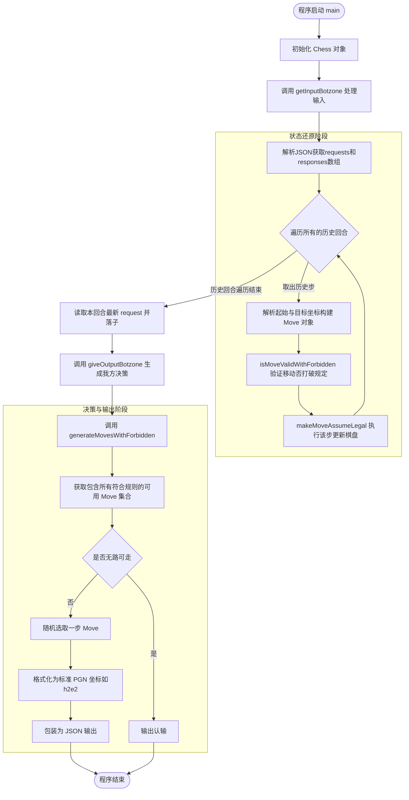
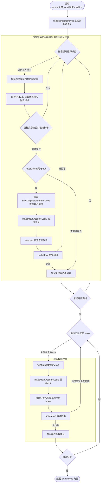
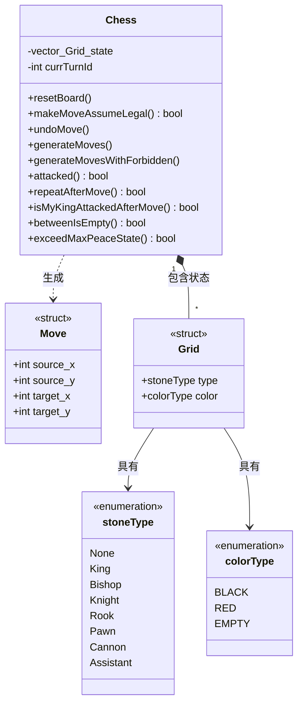

# 中国象棋 Botzone 评测程序流程与架构图

本程序以无状态回合机制为基础，依赖重放全局历史步来还原棋盘状态并进行后续博弈。以下是程序中核心流程以及数据结构的图解分析：

## 一、 程序整体运行流程图 
整个程序的运行从 `main()` 开始，读取平台给定的 JSON 历史交互数组，通过步步重演恢复当前战局，并生成应答步。

## 二、 生成着法与禁手检测流程图
本部分详细展开 `generateMovesWithForbidden()` 内部校验合法性、防御送将与长将禁手规则逻辑的过程，这也是象棋规则引擎最复杂的部分。

## 三、 数据结构与类间关系图
程序的底层由几个核心结构来支撑，主要围绕全局对象 `Chess` 的成员状态及其函数划分。

