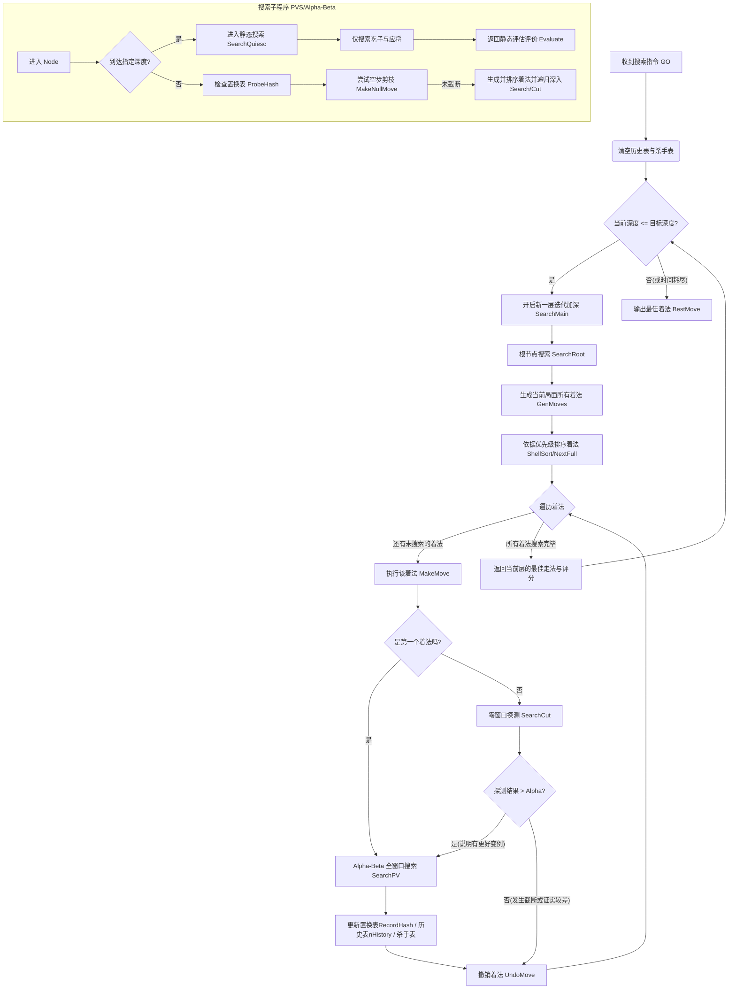

# 象眼对战程序博弈树构建与搜索算法分析

在象眼（ElephantEye）中国象棋AI中，博弈树的构建是整个程序的核心，它决定了AI的棋力。程序的搜索算法不仅使用了经典的最小-最大（Minimax）原理，更结合了众多现代计算机博弈的高级优化技术，如 Alpha-Beta 剪枝、PVS、空步剪枝、置换表、历史表等。

以下是象眼程序在博弈树构建过程中的详细算法分析和流程。涉及的核心代码均位于 `search.cpp`, `genmoves.cpp`, `hash.cpp`, `movesort.cpp` 和 `preeval.cpp` 中。

## 一、 核心搜索框架：迭代加深与 PVS

博弈树的构建并非一次性深入到目标深度，而是采用了**迭代加深（Iterative Deepening）**的策略。

### 1. 迭代加深搜索 (Iterative Deepening Search)
*   **代码实现**：调用 `search.cpp` 中的 `SearchMain()` 函数。
*   **原理**：程序从深度 1 开始搜索，完成之后再搜索深度 2，依此类推，直到达到预定的搜索时间或最大搜索深度。
*   **优势**：
    *   **时间控制**：随时可以响应时间结束的中断信号，立即返回当前已完成的最佳结果。
    *   **排序优化**：浅层搜索得到的结果（尤其是主变例和置换表）可以极大地改善深层搜索时的着法排序，使得 Alpha-Beta 剪枝的效率成倍提高。

### 2. 主要变例搜索 (Principal Variation Search, PVS) / NegaScout
*   **代码实现**：调用 `search.cpp` 中的 `SearchPV()` 以及内部探测函数 `SearchCut()`。
*   **原理**：在 Alpha-Beta 的基础上，假设第一个搜索的着法（通常是置换表命中或浅层验证的好步）就是最佳着法（即属于“主要变例”）。
*   **执行**：
    *   对第一个着法进行**全窗口搜索**（使用正常的 `[-Beta, -Alpha]` 范围）。
    *   对随后的其他着法，首先极其乐观地使用**零窗口**或极窄窗口（`[-Alpha - 1, -Alpha]`）在 `SearchCut()` 中进行试探性搜索。
    *   如果零窗口搜索结果表明当前着法比预期的好（即返回值 > Alpha），说明前面的假设错误，此时才重新使用全窗口进行重新搜索（Re-search）。

## 二、 剪枝技术 (Pruning Techniques)

博弈树的节点呈指数级增长，象眼使用了多种剪枝手段来剔除无用分支：

1.  **Alpha-Beta 剪枝**：最底层的裁剪手段，在 `SearchPV()` 和 `SearchCut()` 中的核心逻辑，剔除对手绝对不会走的差劣分支。
2.  **置换表 (Transposition Table / Hash Table)**：
    *   **代码实现**：调取 `hash.cpp` 中的 `ProbeHash()` 和 `RecordHash()`。
    *   利用 Zobrist 散列算法将每个局面映射为一串哈希值。如果在搜索当前节点时，发现该局面之前已经搜索过且深度足够，则直接调取之前的结果（确切值、上边界或下边界），避免重复构建博弈树分支。
3.  **空步剪枝 (Null Move Pruning)**：
    *   **代码实现**：在 `search.cpp` 的 `SearchCut()` 实现。通过调用局面结构体内的 `MakeNullMove()`。
    *   在特定条件下（如己方未被将军），假定当前局面我们“放弃一步”（走空步），直接让对方走棋。如果对方连走两步后，我们依然处于优势（返回值 >= Beta），则说明当前局面我们的优势极大，真实走棋只会更好，因此直接截断该分支。
4.  **内部迭代加深 (IID - Internal Iterative Deepening)**：
    *   **代码实现**：在 `SearchPV()` 中处理（当深度 `nDepth >= IID_DEPTH` 且没有从置换表中获取着法时）。
    *   如果在 PV 节点没有从置换表中命中合适的最佳着法指引，通过降低深度先做一次浅搜，获取一个相对可靠的优先着法，以此触发后续的 Alpha-Beta 截断。
5.  **无害剪枝 (Harmless Pruning)** / 前向剪枝：
    *   **代码实现**：在节点开始前调用 `search.cpp` 中的 `HarmlessPruning()`。
    *   检查是否遇到不变作和、重复局面等可以立即结束分支的特殊情况。

## 三、 着法生成与节点展开 (Move Generation)

在博弈树的每一个节点，都需要生成合法的子节点。象眼的着法生成在 `genmoves.cpp` 中分为不同阶段：

1.  **吃子着法 (Captures)**：调用 `genmoves.cpp` 中的 `GenCapMoves()`，优先生成具有进攻性的着法。
2.  **非吃子着法 (Non-Captures / Quiet Moves)**：调用 `genmoves.cpp` 中的 `GenNonCapMoves()` 做普通的平移走法。
3.  **MVV/LVA 启发式**：即“最有价值受害者/最无价值攻击者”。调用 `genmoves.cpp` 中的 `MvvLva()` 函数。在吃子着法中，优先考虑用低价值的子（如兵）吃掉对方高价值的子（如车），使得收益最大化。

## 四、 着法排序 (Move Sorting) 

**良好的着法排序是 Alpha-Beta 剪枝效率的命脉。** 如果最好的着法总是第一个被搜索到，剪枝率就能达到理论最大值。象眼在 `movesort.cpp` 的 `MoveSortStruct::NextFull()` 中，按照以下优先级对待评估着法进行排序：

1.  **置换表指引 (Hash Move)**：上一轮迭代或相同局面下的历史最优走法。
2.  **吃子走法 (Good Captures)**：经过 MVV/LVA 排序评估认为是“好”的吃子。
3.  **杀手走法 (Killer Heuristic)**：在兄弟节点中引起了 Beta 截断的“非吃子”着法（记录在类内的 `mvKiller1`, `mvKiller2` 中）。这说明这些着法在当前搜索树深度极具威力。
4.  **历史表走法 (History Heuristic)**：调用 `movesort.cpp` 的 `MoveSortStruct::SetHistory()`，通过一个全局二维数组 `nHistory` 统计搜索全局中，哪些着法频繁引起了截断。被证明成功率越高的着法，即使它是一个普通走法，也会被排在前面。
5.  **一般着法**：在 `movesort.cpp` 中调用基于增量步长数组的 `ShellSort()` 处理后的普通着法。

## 五、 静态搜索 (Quiescence Search)

当到达搜索深度（叶子节点）时，不能直接调用静态评估函数（`Evaluate()`），否则会产生**水平线效应 (Horizon Effect)**（比如马上要被吃掉一个车，但因为深度到了，评估函数只看到了当前子力，误认为均势）。
*   **代码实现**：到达固定深度后，由 `SearchPV` 等跳转调用 `search.cpp` 中的 `SearchQuiesc()` 函数。而在绝对静止的叶子节点，最终调用 `preeval.cpp` 或其中的逻辑提供打分。
*   **静态搜索**：在深度耗尽后，继续展开**只包含吃子和应将**的博弈树分支，直到局面彻底“平静”（不再有激烈的子力交换），此时再给出评估值。

---

## 六、 博弈树构建整体流程图

