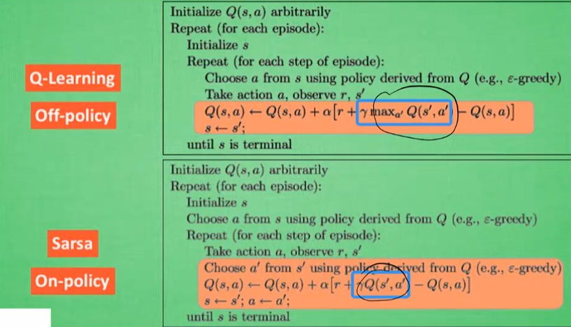

# 强化学习

## Q1 ML、DL、RL的联系

### 1. 它们之间的关系

可以用**包含关系**和**交叉关系**来描述：

* **人工智能 (AI) > 机器学习 (ML) > 深度学习 (DL)**：
  * **机器学习**是人工智能的一个子集，指的是让计算机通过数据自动学习规律，而不是通过显式的编程。
  * **深度学习**是机器学习的一个特殊子集，它专门指使用**多层神经网络**（深度神经网络）来处理数据的技术。
* **强化学习 (RL) 与它们的关系**：
  * 强化学习是机器学习的三大范式之一（另外两个是**监督学习**和**无监督学习**）。
  * 当强化学习使用了深度神经网络作为函数近似器时，它被称为**深度强化学习 (Deep RL)**。因此，强化学习与深度学习有很大的**交集**，但并不完全等同。

---

### 2. 详细介绍与逻辑区别

| 类别                    | 核心逻辑                                     | 学习方式                                                                  | 举例说明                                                                     |
| :---------------------- | :------------------------------------------- | :------------------------------------------------------------------------ | :--------------------------------------------------------------------------- |
| **机器学习 (ML)** | 通过统计学方法在数据中寻找模式。             | 输入特征$\rightarrow$ 模型 $\rightarrow$ 输出标签。                   | 预测房价。根据面积、地段等特征算出价格。                                     |
| **深度学习 (DL)** | 模仿人脑神经元结构，自动提取高维特征。       | 原始原始数据（如像素）$\rightarrow$ 多层网络 $\rightarrow$ 高级语义。 | 识别照片中是猫还是狗。你不需要告诉系统“猫有尖耳朵”，它自己会从像素中学习。 |
| **强化学习 (RL)** | 通过与环境交互，获得奖惩，学习最优决策序列。 | 状态$\rightarrow$ 动作 $\rightarrow$ 奖励。                           | 培养一个下围棋的智能体。赢了给正反馈，输了给负反馈。                         |

---

### 3. 实际应用场景

#### **机器学习 (Machine Learning)**

多用于传统的结构化数据处理和预测：

* **金融风控**：根据用户的消费习惯、信用记录预测贷款违约风险。
* **垃圾邮件过滤**：通过统计邮件中关键字的频率来判断是否为垃圾邮件。
* **推荐系统**：电商平台根据你过去的浏览历史推荐商品。

#### **深度学习 (Deep Learning)**

擅长处理非结构化数据（图像、声音、文本）：

* **计算机视觉 (CV)**：人脸识别、自动驾驶（识别行人、红绿灯）、医学影像辅助诊断（肿瘤识别）。
* **自然语言处理 (NLP)**：机器翻译、ChatGPT 等大语言模型、语音转文字。
* **生成式 AI**：AI 绘画（如 Midjourney）、AI 换脸。

#### **强化学习 (Reinforcement Learning)**

侧重于“决策”和“动态交互”：

* **游戏 AI**：AlphaGo（围棋）、星际争霸 AI、王者荣耀 AI（通过无数次对战演练出最强策略）。
* **机器人控制**：训练波士顿动力的机械狗行走、平衡，或工业机器人的精准抓取。
* **量化交易**：在复杂的股市环境中，通过试错学习买入和卖出的最佳时机。
* **能源优化**：Google 使用 RL 优化数据中心的冷却系统，显著降低了能耗。

### 总结

* **机器学习**是地基，包含了所有学习算法。
* **深度学习**是“重型武器”，用神经网络解决极其复杂的模式提取问题。
* **强化学习**是“进化论”，让机器在不断的尝试与失败（试错）中学会如何达成目标。

## Q2 Q-learning

$ Q(s,a) \leftarrow Q(s,a) + \alpha \left[ r + \gamma \ max_{a'} Q(s',a') - Q(s,a)\right]$

其中，

* $Q(s,a)$：当前状态 s**s** 下采取动作 a**a** 的价值。
* $\alpha$：学习率 (Learning Rate)。
* $r$：即时奖励 (Reward)。
* $\gamma$：折扣因子 (Discount Factor)。
* $\max_{a'} Q(s',a') - Q(s,a)$：在下一个状态 s′下，预期能获得的最大未来价值。

##  Q3 Q-learing 和 sarsa算法总结

什么是神经网络？代码是怎样跑通的？

## Q4：DQN算法

$\epsilon - greedy$ 算法

什么是网络？

什么是反向传播？
