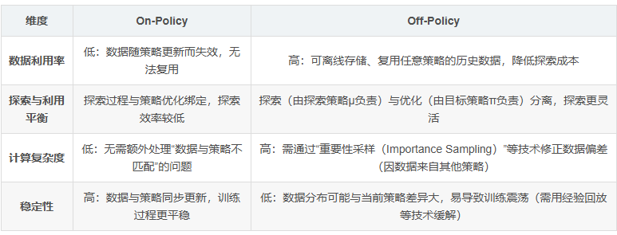
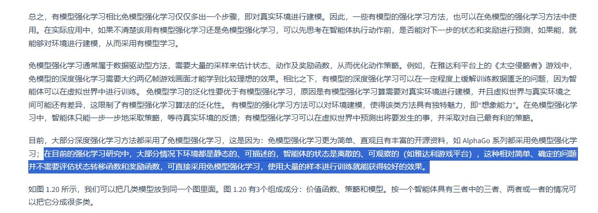
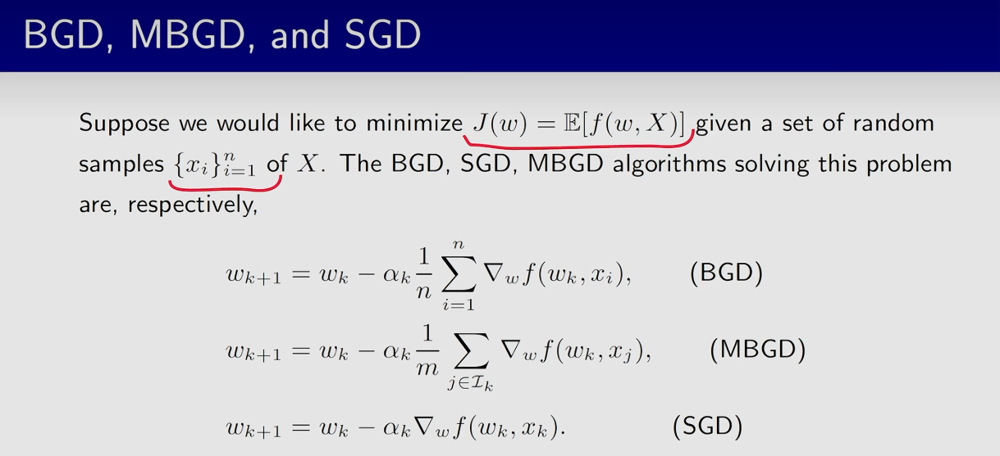

## V值与Q值

在强化学习中，存在两种核心的价值函数，它们各自对应一种贝尔曼方程形式：

1. **状态价值函数（State-Value Function，$V(s)$）**：
   计算的是**处于某个状态 $s$ 的期望**。它表示智能体在状态 $s$ 之下，之后一直遵循给定的策略 $\pi$ 进行决策，所能获得的期望累积未来奖励。
   贝尔曼方程形式：$V_\pi(s) = \sum_a \pi(a|s) \sum_{s', r} p(s', r | s, a) \left[ r + \gamma V_\pi(s') \right]$
2. **动作价值函数（Action-Value Function，$Q(s, a)$）**：
   计算的是**处于某状态 $s$ 、且进行了某个明确动作 $a$ 的期望**。它表示在状态 $s$ 下首先执行动作 $a$，此后一直遵循策略 $\pi$ 所能获得的期望累积未来奖励。
   贝尔曼方程形式：$Q_\pi(s, a) = \sum_{s', r} p(s', r | s, a) \left[ r + \gamma \sum_{a'} \pi(a'|s') Q_\pi(s', a') \right]$

（注：Q-learning 试图逼近的是最优策略的动作价值 $Q^*(s, a)$，其对应的贝尔曼最优方程为 $Q^*(s, a) = \sum_{s', r} p(s', r | s, a) [r + \gamma \max_{a'} Q^*(s', a')]$）。

---

*不知道环境运行的具体概率公式（无模型），且算力无法支持庞大状态空间的方程联立，所以只能依靠 Q-learning 这种基于经验的“一步步试错更新”的方法来近似求解。*

## On-Policy 和 Off-policy

1. On-Policy：“边走边学，只信自己当前的步子”
   假设机器人用 ε-贪心策略（ε-greedy） 探索（90%概率选当前认为最优的步幅，10%随机试错）：

它每走一步（执行动作），都会记录“当前状态（如地面坡度）→ 动作（步幅10cm）→ 奖励（是否摔倒/走稳）”的数据；
训练时，只能用这组“刚走出来的数据”更新策略（比如调整步幅到12cm）；
下次走路时，用更新后的新策略重新生成数据，再继续训练——旧策略生成的“步幅8cm”的数据无法复用，因为当前策略已变。
典型算法：Sarsa（时序差分学习的同策略版本）。

2. Off-Policy：“参考别人的走路记录，自己偷偷学最优走法”
   机器人依然用ε-贪心策略（μ）探索（负责“试错、收集数据”），但训练时：

它会记录“探索策略μ的所有数据”（比如步幅8cm、10cm、15cm的尝试结果）；
训练时，不直接优化探索策略μ，而是从这些数据中提取“对最优策略π有用的信息”（比如发现“步幅12cm时摔倒最少”，即使探索策略很少选12cm）；
甚至可以复用“去年其他机器人学走路的历史数据”，无需自己重新试错——数据来源完全独立于当前优化的策略π。
典型算法：Q-Learning（时序差分学习的异策略版本）、DQN（深度Q网络）

## 程序实例——Q_learing_1.cpp中用到的强化学习方法和公式

1.终止状态更新：

$$
Q(s,a)\leftarrow Q(s,a) + \alpha \big(r-Q(s,a)\big),\quad r\in\{+1,-1\}
$$

2.非终止状态更新：

$$
Q(s,a)\leftarrow Q(s,a)+\alpha\Big(r+\gamma\max_{a'}Q(s',a')-Q(s,a)\Big)
$$

其中本程序 $r = 0$

3.下一轮状态最优估计

$$
\max Q(s')=\max_{a'\in A(s')}Q(s',a')
$$

4.训练时的行为动作

$\pi(a|s)=\begin{cases}\text{随机动作}, & \text{概率 } \epsilon\\\arg\max_a Q(s,a), & \text{概率 } 1-\epsilon\end{cases}$

经典马尔可夫模型四元组(S,A,P,R)

考虑设计N元组，并分别形成Q/以及其它表，常数写出程序

## 如何理解蒙特卡洛？

你的理解已经很接近标准的蒙特卡洛控制了，关键只差一层：**它不是“枚举所有轨迹”的暴力法，而是“从分布中抽样”的统计估计法**。

1. 蒙特卡洛在做什么用当前策略跑很多回合（episode），对每次出现的状态-动作 $(s,a)$ 记录后续回报 $G_t$，然后用样本均值估计
   $Q^\pi(s,a)\approx \frac{1}{N(s,a)}\sum_{i=1}^{N(s,a)} G_i(s,a).$
   所以它是“采样平均”，不是把所有可能轨迹全算一遍。
2. 为什么看起来又“贪心”又“探索”
   这两件事不矛盾，是强化学习的核心张力（exploration-exploitation）：

- 策略改进时，你会朝着 $\arg\max_a Q(s,a)$ 变得更贪心（利用）。
- 采样时，你通常不会 100% 贪心，而是用 $\epsilon$-greedy 或 soft policy 保留探索概率（探索）。

常见做法是 GLIE 思想：前期较大 $\epsilon$ 多探索，后期让 $\epsilon\to 0$ 逐渐更贪心。所以不是“既要枚举又要贪心”，而是“**用少量随机探索保证覆盖，再用贪心改进提高性能**”。

3. 它算不算“暴力”
   看你怎么定义“暴力”：

- 若“暴力”= 穷举所有轨迹：**不是**。
- 若“暴力”= 不用模型、靠大量样本硬估计：**某种意义上是**（sample-heavy）。

蒙特卡洛的特点确实是：

- 优点：简单、无偏（对 $Q^\pi$ 的样本均值估计）、不需要环境模型。
- 缺点：方差大、样本效率不高、通常需要完整回合结束后更新。

一句话总结：**蒙特卡洛控制是“采样统计 + 渐进贪心改进”，不是逻辑矛盾，而是强化学习标准范式。**

12

## BGD MBGD 和 SGD

