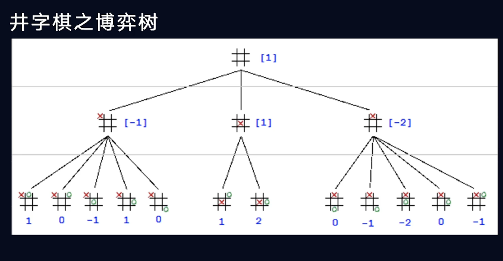
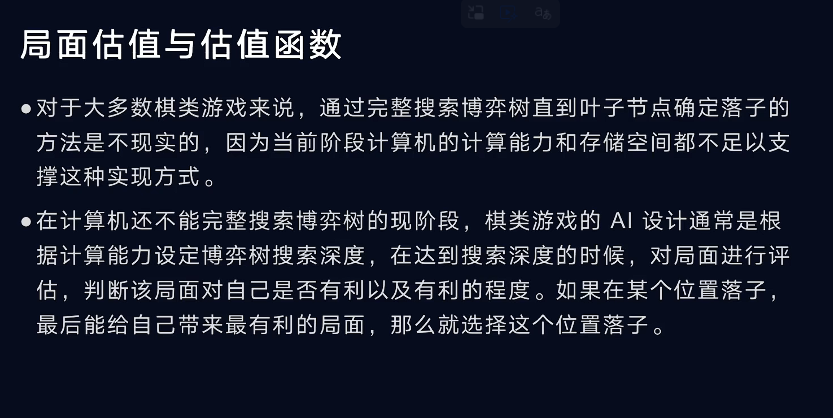
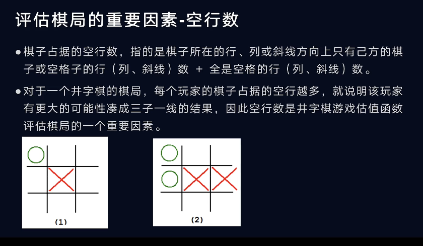
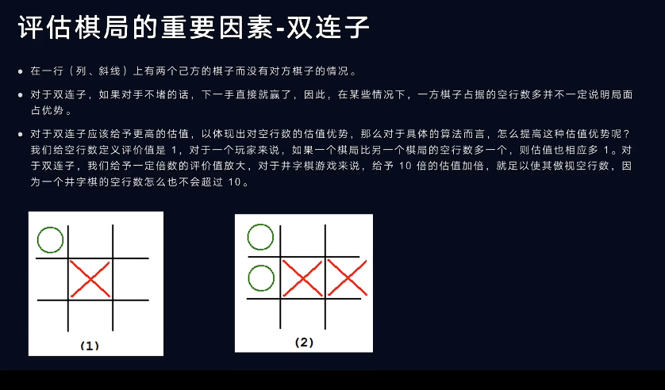
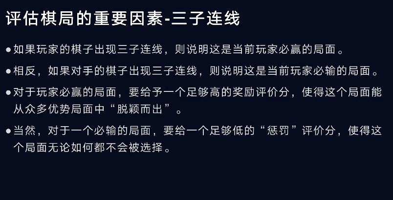
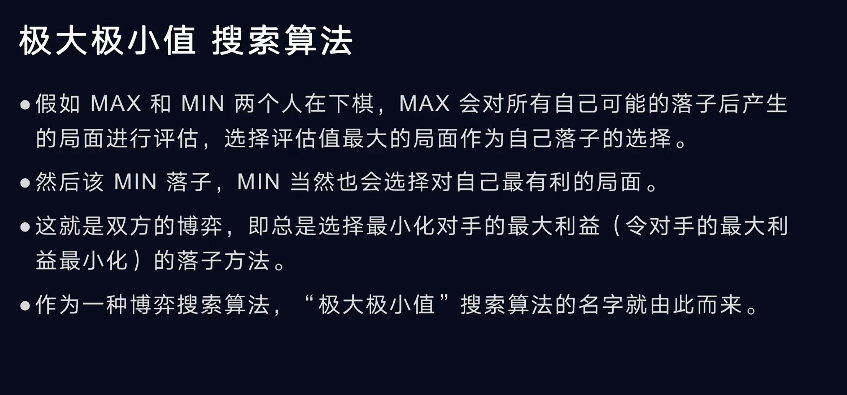

Link:[棋类游戏人机博弈算法讲解 - 井字棋_哔哩哔哩_bilibili](https://www.bilibili.com/video/BV1b44y1n7To/?spm_id_from=333.337.search-card.all.click&vd_source=00d6f74ef67db5abc47fe7ba2dc24262)

## 一、构建博弈树

## 二、确定估值方法

### 如何评估？

### 1.“单子”情况

### 2.“双子”情况

### 3."三子"情况

## 三、算法设计

根据博弈树，使用极大极小值算法和剪枝算法

### 极大极小值算法：让对手的MAX取得MIN

使用$\alpha-\beta 剪枝$
