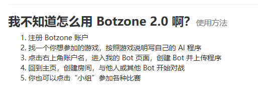

# 井字棋bot构建

### 1.Botzone 井字棋裁判代码及 JSON 交互的问题

1. jsoncpp/json.h 是用来做什么的？
   jsoncpp/json.h 是一个开源 C++ 库 JsonCpp 的头文件。它的主要作用是让 C++ 程序能够解析（Read）和生成（Write） JSON 格式的数据。
   在 Botzone 环境中，裁判程序（Judge）与各个 Bot（AI）之间通过标准输入输出（stdin/stdout）进行通信。由于比赛数据（如棋盘状态、历史记录、非法动作等）结构较复杂，直接传输字符串非常难以维护，因此使用 JSON 这种通用的数据交换格式。
2. Json:: 命名空间是什么？
   Json:: 是 JsonCpp 库定义的命名空间。代码中常见的几个核心类都属于这个空间：
   •	Json::Value：这是最核心的类，它可以表示 JSON 中的任何类型（整数、浮点数、字符串、布尔值、数组或对象）。
   •	例如：gridInfo[x][y] = content["x"].asInt(); 就是将 JSON 对象中键为 "x" 的值转为 C++ 的 int。
   •	Json::Reader：用于将 JSON 字符串解析为 Json::Value 对象。
   •	代码示例：reader.parse(str, input);
   •	Json::FastWriter：用于将 Json::Value 对象转换回紧凑的字符串，以便输出给 Botzone 平台。
   •	代码示例：writer.write(output);

3. “JSON 交互”是什么？
   在 Botzone 平台，“交互方式”决定了平台如何将信息发送给你的 Bot，以及你的 Bot 应该如何返回结果。
   •	简单交互（Simple IO）： 数据以简单的空格或换行分隔的数字/字符串形式给出。例如：直接读入两个整数 3 3。这适合逻辑非常简单的游戏。
   •	JSON 交互（Full JSON Interaction）： 这是 Botzone 推荐的高级方式。平台会将整个对局的历史记录（包括每一回合双方的动作、选取的参数等）打包成一个大的 JSON 对象发送给 Bot。
   •	优势：你的 Bot 不需要自己在内存中维护棋盘状态，因为每一回合你都会收到完整的 log。

4. 处理流程：

1. Bot 接收到一个 JSON 字符串（包含历史对局）。
2. 使用 Json::Reader 解析该字符串。
3. 根据 log 中的数据恢复当前棋局。
4. 计算出新的一步。
5. 构建一个包含动作信息的 Json::Value 对象。
6. 使用 Json::FastWriter 打印出 JSON 字符串给平台。
   总结： 在你提供的代码中，裁判程序正在解析平台的 log 字段，判断历史动作是否合法，并根据游戏规则计算胜负，最后通过 JSON 格式输出判定结果。如果不勾选“简单交互”，你的 Bot 也必须使用类似的 JSON 库来处理这些输入输出。

### 2.botzone评测和bot程序运行流程

在 Botzone 平台上构建一个 Bot，本质上是编写一个能够读取对局日志（JSON 格式）、分析棋局状态并输出下一步动作的控制台程序。
根据 Tiptoe_Main.cpp 裁判代码的逻辑，你的 Bot 需要满足：

1. 读取输入：从标准输入读取一行 JSON 字符串，解析其中的 log。
2. 恢复状态：根据 log 里的历史动作重构 3x3 棋盘。
3. 做出决策：找到一个空位落子。
4. 格式输出：向标准输出打印出包含 x 和 y 坐标的 JSON 字符串。

示例代码：

Resources\参考代码\井字棋示例bot代码.cpp
